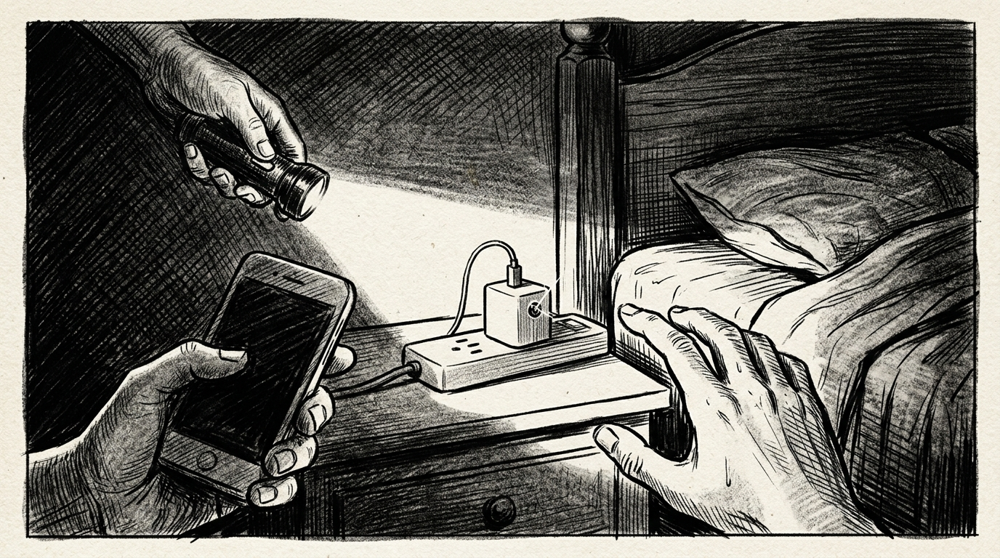

# 자동 연결 — Threads 연재본 (4화 완결)

> 장르: 현실 밀착 미스터리·스릴러 / 창작 단편 / 기승전결 4화 완결
>
> **게시 방식:** 아래 각 `text` 블록의 본문만 복사하여 **1화당 1게시물**로 올리세요. 각 화는 500자 이내이며, 마지막 4화에 클라이맥스 컷신 이미지를 함께 첨부합니다.

---

## 1화 (기)

```text
[1화] 거실 한가운데

지하철에서 잃어버린 에어팟 한쪽이, 지금 우리 집 거실 한가운데에 있다고 떴다.

‘나의 찾기’ 앱을 새로고침해도 위치는 같았다. 아무것도 없는 빈 바닥.

오류겠거니 하고 ‘사운드 재생’을 눌렀다.

삐비빅, 삐비빅.

소리가 진짜 집 안에서 났다. 바닥이 아니라 머리 위, 거실 천장 환풍구 안쪽이었다.

의자를 밟고 올라가 환풍구 덮개를 열었다. 먼지 쌓인 배관 구석에 내 에어팟이 있었고, 그 옆에 보조배터리에 연결된 낯선 공기계 하나가 놓여 있었다.

꺼내 보니 화면은 켜져 있었고, 상태 표시줄엔 이렇게 떠 있었다.

‘통화 중 — 01:42:18’

누군가 내 집 소리를 실시간으로 듣고 있었다.

그때 공기계 화면에 문자 알림이 하나 떴다.

‘가만히 있어. 의자에서 내려오지 말고.’
```

## 2화 (승)

```text
[2화] 유효 거리 10미터

나는 의자 위에서 그대로 얼어붙었다. 집 안에 카메라까지 있는 걸까?

떨리는 손으로 공기계 알림창을 자세히 봤다. 통신사 문자가 아니라 ‘단축어 자동화’ 알림이었다.

[조건: ‘내 에어팟’ 블루투스 연결 해제 시]
[실행: 미리 입력된 텍스트 화면 표시]

내가 환풍구에서 에어팟을 집어 들자 세팅된 문구가 자동으로 뜬 것뿐이었다. 실시간으로 날 보고 있는 게 아니었다.

안도하며 내려오려던 순간, 거실 블루투스 스피커에서 갑자기 ‘띠링’ 하는 연결음이 울렸다.

외부에서 누군가 내 스피커에 접속했다. 블루투스 유효 거리는 최대 10미터.

그 사람이 지금 현관문 밖에 와 있었다.

스피커 코드를 뽑고 현관 안전고리를 걸자마자, 문 너머에서 도어락 버튼 눌리는 소리가 났다.

삑, 삑, 삑, 삑.

비밀번호가 맞았는지 잠금장치가 풀렸고, 안전고리에 걸린 문이 팽팽하게 열렸다.

문틈 사이로 낯선 남자의 눈이 나와 마주쳤다.
```

## 3화 (전)

```text
[3화] 낮 시간의 손님

“누구세요! 지금 경찰 불렀어요!”

내가 소리치자 남자는 아무 말 없이 손에 든 휴대폰 화면을 문틈으로 내밀었다.

방금 내가 환풍구에서 꺼낸 공기계의 사진첩 화면과 똑같은 클라우드 폴더였다.

사진첩엔 지난 한 달간 내가 출근한 낮 시간마다, 내 방 안을 찍은 사진 수십 장이 들어 있었다.

남자가 낮게 말했다.

“이 건물 관리실에 맡겨둔 마스터 비번, 생각보다 쉽게 풀리던데요. 공기계만 조용히 넘기면 다 지우고 갈게요.”

그가 몸으로 문을 세게 밀자 안전고리 나사가 헐거워지며 덜컹거렸다.

나는 공기계를 바닥에 내려놓고 의자 다리로 힘껏 내리쳤다.

“이미 112에 사진이랑 당신 목소리 다 전송했어요!”

동시에 창문을 열고 복도가 떠나가라 비명을 질렀다.

1층 공동현관문이 열리는 소리와 함께 엘리베이터가 올라오는 표시등이 켜지자, 남자는 혀를 차더니 계단실로 사라졌다.
```

## 4화 (결·완결)

```text
[4화·완결] 알 수 없는 기기

범인은 옆 동을 오가며 건물 마스터 비밀번호를 알아낸 배달 기사였다.

현관 앞에서 내가 흘린 에어팟을 주워 환풍구 공기계 옆에 숨겨두고, 내가 낮에 집을 비울 때마다 마스터 번호로 들어와 머물렀던 것이다.

나는 그날로 도어락을 통째로 바꿨다. 마스터키 기능이 아예 없는 모델이었다.

모든 게 끝났다고 생각한 밤, 침대에 누워 관리비 앱을 켰다가 이상한 알림을 봤다.

[지난달 대비 낮 시간대 대기전력 18% 증가]

상세 내역을 누르자 평일 오후 2시부터 4시까지, 매일 전기가 쓰인 곳이 나왔다.

거실이 아니라 ‘안방 침대 옆 콘센트’였다.

범인은 낮마다 내 침대에 누워 휴대폰을 충전하며 시간을 보냈던 것이다.

나는 벌떡 일어나 침대 머리맡 멀티탭을 확인했다.

구석에 내가 꽂아둔 적 없는 흰색 충전 어댑터 하나가 꽂혀 있었다.

뽑으려던 손이 멈췄다. 어댑터 한가운데, 바늘구멍만 한 렌즈가 내 침대를 향하고 있었다.

— 끝 —
```


