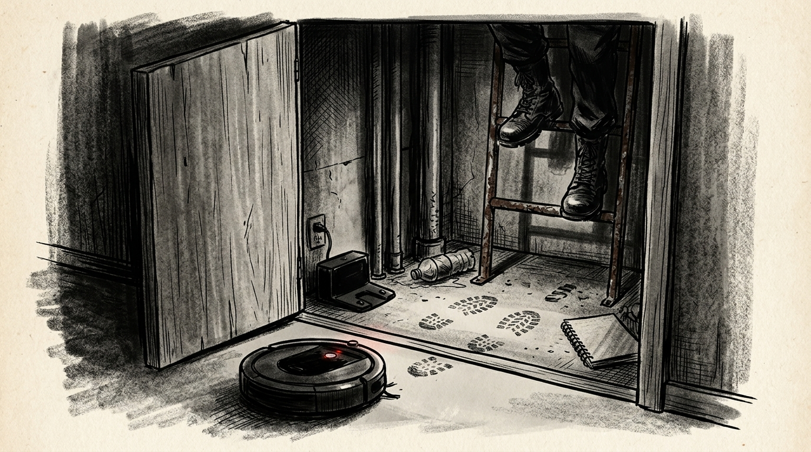

# 벽 뒤의 지도

> 미스터리·스릴러

## 1화

```text
[1화] 우리 집에 없는 방

당근에서 산 중고 로봇청소기가 자꾸 안방 붙박이장 벽을 들이받았다.

앱을 켜보고 더 놀랐다. 붙박이장 뒤편에 우리 집엔 없는 좁은 방이 그려져 있었고, 그 안엔 충전기 표시까지 떠 있었다.

거래할 때 판매자는 분명 이렇게 말했다.
“저도 같은 아파트 1202호 살았어요. 같은 라인이니 지도는 안 지워도 돼요.”
내가 이사 온 곳은 702호였다.

밤 11시, 판매자에게 갑자기 메시지가 왔다.
“지도 삭제하셨나요?”
“아직요. 이상한 방이 하나 뜨네요.”
“혹시 붙박이장 뒤쪽인가요?”

나는 붙박이장이라고 말한 적이 없었다.

긴 침묵 끝에 답이 왔다.
“거기 절대 열지 마세요. 저도 그거 때문에 이사 나왔습니다.”

그때 안방에서 툭, 툭 소리가 났다.
거실에 둔 청소기가 붙박이장 앞에 가 있었다.
```

## 2화

```text
[2화] 열려 있던 자리

판매자의 채팅 프로필은 곧바로 사라졌다.

나는 붙박이장 옷을 걷어내고 한쪽 색이 다른 뒤판 나사를 풀었다. 차가운 공기와 함께 사람이 웅크려 들어갈 만한 배관 공간이 나타났다.

바닥엔 먼지 대신 선명한 신발 자국이 찍혀 있었고, 구석엔 여분의 청소기 충전 도크와 먹다 남은 생수병, 스프링 노트가 놓여 있었다.

노트 표지엔 이렇게 적혀 있었다.
[102동 2호 라인 점검 일지]

‘502호: 평일 낮 부재.’
‘802호: 6개월째 공실.’
‘702호: 이번 주 입주. 23:18 붙박이장 후면 개방.’

바로 방금 전 시간이었다. 누군가 내가 벽을 뜯는 걸 실시간으로 보고 있었다.

그때 발밑의 로봇청소기에서 기계음이 울렸다.
“원격 카메라가 실행되었습니다.”

빨간 렌즈 표시등이 켜진 순간, 머리 위 철제 사다리가 끼익거렸다.
```

## 3화

```text
[3화] 위층에서 내려오는 발소리

위층 공실인 802호와 연결된 점검구 사다리를 타고 누군가 내려오고 있었다.

나는 즉시 공유기 전원을 뽑고 112에 문자 신고를 보낸 뒤, 노트 사진을 찍어 친구에게 전송했다.

바로 그때 현관 초인종이 울렸다. 인터폰 화면엔 관리소장이 서 있었다.
“윗집에서 망치 소리 난다고 민원이 왔어요. 문 좀 여세요.”

“802호는 반년째 공실이잖아요. 누가 신고했다는 겁니까?”

말문이 막힌 소장의 목소리가 낮게 가라앉았다.
“배관 점검 노트만 돌려주시면 조용히 끝납니다.”

동시에 안방 붙박이장 안쪽 합판이 부서지며 작업복 입은 남자가 기어 나왔다.

나는 창문을 활짝 열고 복도가 떠나가라 소리쳤다.
“사람 살려 주세요! 702호입니다! 지금 경찰이 통화로 다 듣고 있어요!”

이웃집 문들이 열리는 소리와 함께 사이렌 소리가 단지 안으로 들어오자, 남자와 소장은 얼굴이 하얗게 질린 채 붙잡혔다.
```

## 4화

```text
[4화·완결] 여섯 개의 나사

조사 결과는 소름 끼쳤다.

관리소장과 점검 기사는 비어 있던 802호의 배관 통로를 임의로 넓혀두고, 입주민들이 집을 비운 낮 시간마다 벽 뒤를 통해 집안을 드나들며 귀중품을 빼돌리고 있었다.

1202호 전 주인은 관리실 직원의 폰에 청소기 앱 계정이 연동된 줄도 모른 채, 누군가 자기 말을 믿어주길 바라며 지도를 남긴 채 청소기를 넘겼던 것이다.

수리 기사가 붙박이장 뒤판을 다시 단단히 막았다.
초기화한 청소기가 새로 그린 지도에는 거실과 안방, 작은방만 깔끔하게 남았다.

하지만 나는 오늘 밤도 잠들기 전 안방 붙박이장 문을 열고 뒤판의 나사 여섯 개를 손끝으로 하나씩 짚어본다.

무서운 건 벽 뒤의 빈 공간이 아니었다.
누군가 그 길을 알고 있었고, 집주인인 우리만 몰랐다는 사실이었다.

— 끝 —
```


