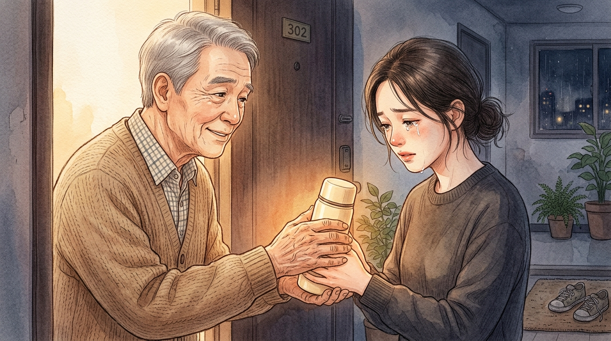

# 밤 11시의 초인종

> 일상·드라마

## 1화

```text
[1화] 밤 11시의 움직임 감지

이사를 온 뒤로 돌 막 지난 아이가 낯선 집이 무서운지 매일 밤 11시만 되면 자지러지게 울었다.

아랫집에 죄송해서 아이를 안고 거실 매트 위를 동동거리며 달래는데, 나흘 전부터 소름 돋는 일이 시작됐다.

아이가 울기 시작하는 밤 11시경이면 어김없이 현관 도어캠에 ‘움직임 감지’ 알림이 뜨는 것이다.

앱을 켜서 화면을 보면, 아랫집에 혼자 사시는 무표정한 할아버지가 우리 집 현관문 앞에 우두커니 서 계셨다.

그러고는 초인종에 손을 뻗었다가 거두기를 수차례 반복한 뒤, 한참 동안 문만 바라보다 내려가셨다.

오늘 밤도 도어캠 화면에 할아버지의 그림자가 잡힌 순간, 나는 덜컥 겁이 나면서도 죄송하다고 빌 각오로 현관문을 벌컥 열었다.
```

## 2화

```text
[2화] 누르지 못한 손끝

문을 열자마자 내가 먼저 고개를 깊이 숙이며 다급하게 말했다.

"어르신, 밤마다 아기 울음소리 때문에 그러시죠? 정말 죄송합니다. 아기가 아직 새집에 적응을 못 해서요… 내일 찾아뵈려 했는데…"

그런데 문 앞에 서 계시던 할아버지는 화를 내기는커녕 화들짝 놀라시더니, 등 뒤로 감추고 있던 손을 슬그머니 내미셨다.

할아버지의 거친 손에 들려 있던 건 항의 쪽지가 아니라, 김이 모락모락 나는 보온병 하나였다.

"아이고, 새댁… 시끄러워서 올라온 게 아니여. 밤에 초인종 누르면 겨우 달래놓은 아기 더 놀랄까 봐, 차마 못 누르고 서 있었구먼."

전혀 예상치 못한 대답에 나는 할 말을 잃은 채 할아버지의 얼굴만 멍하니 바라보았다.
```

## 3화

```text
[3화] 천장 너머의 울음소리

할아버지가 멋쩍게 웃으며 따뜻한 보온병을 내 손에 쥐여주셨다.

"우리 할망구가 재작년에 떠나기 전까지 여기서 손주 셋을 다 키워봤어. 밤마다 위에서 아기 우는 소리가 나는데, 사흘 전부턴 아기 엄마가 숨죽여 우는 소리가 같이 섞여 들리더라고."

그 말을 듣는 순간 심장이 쿵 내려앉았다.
아이가 그치지 않을 때마다 거실 구석에 주저앉아 아이를 안고 몰래 삼키던 내 울음소리를, 할아버지는 다 듣고 계셨던 것이다.

"아기 달래느라 엄마가 저녁도 못 챙겼을 텐데, 속 편해지는 따뜻한 대추차여. 찬 바닥에 그냥 두고 가면 식을까 봐, 문고리에 걸지도 못하고 망설였네."

내 손바닥에 닿은 보온병이 데일 것처럼 뜨거웠다.
```

## 4화

```text
[4화·완결] 사람 사는 소리

할아버지는 뒤돌아 계단을 내려가시며 조용히 덧붙이셨다.

"새댁, 미안해하지 말어. 할망구 떠나고 나서 집안이 무덤처럼 적막했는데, 위에서 아기 소리랑 총총거리는 발소리가 나니까 나도 이제야 숨이 쉬어져. 아기는 원래 우는 거니까, 엄마는 미안해서 울지 말어."

닫힌 현관문 앞에 기대어 보온병을 끌어안은 채, 나는 그 자리에서 한참을 소리 죽여 울었다.

그동안 도어캠에 찍혔던 할아버지의 망설이던 손끝은 항의가 아니라, 초인종 소리에 아기가 깰까 봐 누르지 못한 다정한 배려였다.

다음 날 아침, 나는 푹 자고 일어난 아이를 안고 할아버지 댁 문 앞에 따뜻한 국 한 냄비와 함께 진짜 첫인사를 드리러 내려갔다.

— 끝 —
```


