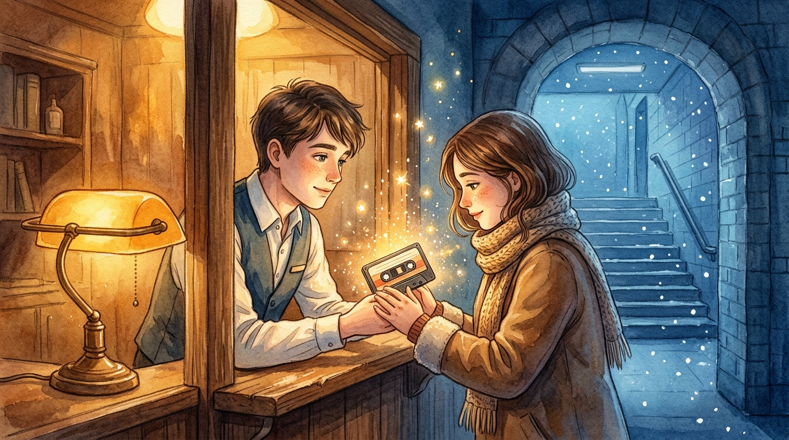

# 분실물 보관소의 유통기한

> 감성 판타지·로맨스

## 1화

```text
[1화] 새벽 1시의 유실물 센터

내 직업은 지하철 종착역 유실물 센터의 야간 근무자다.

낮에는 우산이나 지갑을 찾아주지만, 막차가 끊긴 새벽 1시가 되면 이곳엔 조금 특별한 분실물이 입고된다. 승객들이 열차에 깜빡 두고 내린 ‘기억의 조각’들이다.

오늘 밤 선반 맨 앞칸에서 옅은 빛을 내는 건, 7년 전 겨울 2호선 열차에서 수거된 낡은 카세트테이프 모양의 기억 하나였다. 바랜 라벨 위엔 연필로 이렇게 적혀 있었다.

[2019년 12월 24일, 시청역에서 삼킨 고백 — 보관 만료 D-1]

기억의 유통기한은 딱 7년뿐이다. 오늘 밤 자정이 지나면 이 기억은 주인의 머릿속에서 영원히 소멸된다.

바로 그때, 눈 내리는 계단을 내려와 창구 유리창 앞에 한 여자가 가쁜 숨을 몰아쉬며 멈춰 섰다.
```

## 2화

```text
[2화] 본인 확인 절차

"저… 7년 전 크리스마스이브에 2호선에서 잃어버린 게 있어서요."

여자의 코끝과 속눈썹이 바깥 추위로 발갛게 얼어 있었다. 내가 선반에서 카세트테이프를 꺼내 들자 여자의 눈이 놀란 듯 커졌다.

"맞아요, 그거예요! 그날 이후로 그 사람의 얼굴이랑 마지막에 하려던 말만 안개에 가린 것처럼 도무지 생각이 안 났거든요."

나는 매뉴얼에 따라 침착하게 안내했다.
"유통기한 마지막 날이라 주인 본인인지 확인해야 수령하실 수 있습니다. 태엽을 감아 첫 장면을 재생해 볼게요."

태엽을 돌리자 창구 유리 위로 7년 전 전동차 안의 풍경이 아지랑이처럼 피어올랐다. 덜컹거리는 열차 안, 여자와 마주 서 있던 남자의 얼굴이 선명해진 순간 내 심장이 쿵 내려앉았다.

기억 속 남자는, 7년 전의 나였다.
```

## 3화

```text
[3화] 맞바꾼 기억의 대가

왜 그동안 이 여자를 알아보지 못했을까. 나는 떨리는 손으로 카세트테이프 케이스 안쪽의 노란 접수증을 뒤집어 보았다.

거기엔 7년 전의 내가 직접 볼펜으로 눌러 쓴 문장이 희미하게 남아 있었다.

[특이사항: 수취인의 아픈 이별 기억을 유예하기 위해, 위탁자가 자신의 기억과 시간을 담보로 야간 근무를 자청함.]

그제야 멈춰 있던 시간들이 한꺼번에 밀려왔다. 7년 전 그날 밤, 유학길에 오르던 그녀가 나 때문에 울며 공항행 열차를 놓치려 했을 때, 내가 이곳에 찾아와 우리의 기억을 봉인하고 야간 근무자가 되었던 것이다.

"어라… 이상하네요."

홀로그램 속 내 얼굴을 빤히 바라보던 여자가 천천히 고개를 들어, 창구 너머에 앉은 나를 똑바로 마주 보았다.

"기억 속 저 사람… 지금 제 앞에 있는 당신 맞죠?"
```

## 4화

```text
[4화·완결] 자정을 넘긴 고백

자정을 알리는 벽시계 초침이 마지막 숫자를 향해 가쁘게 움직였다.

"이 테이프를 가져가시면, 7년 동안 저를 잊고 지냈던 미안함까지 전부 돌아오게 됩니다. 그래도 수령하시겠습니까?"

내 물음에 여자는 망설임 없이 창구 틈으로 손을 뻗어, 테이프를 쥔 내 손등 위를 따뜻하게 포개 잡았다.

"네. 이번엔 절대 안 잃어버릴게요."

자정 정각을 알리는 종소리와 함께, 낡은 테이프가 금빛 먼지처럼 부서지며 두 사람의 손끝으로 스며들었다. 7년 전 시청역에서 삼켰던 나의 고백과 그녀가 미처 건네지 못했던 대답이 마침내 하나의 기억으로 이어졌다.

내 가슴에 달려 있던 ‘야간 근무자’ 명찰이 바닥으로 툭 떨어졌다. 나는 7년 만에 처음으로 창구 문을 열고 나와, 눈 내리는 첫차 승강장으로 그녀의 손을 잡고 걸어 나갔다.

— 끝 —
```


