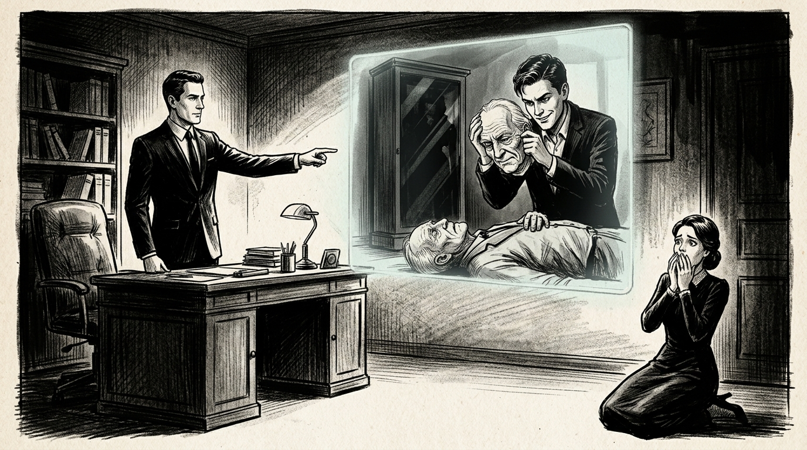

# 기억 감사관

> SF 추리·스릴러

## 1화

```text
[1화] 완벽한 자살의 기억

내 직업은 죽은 이의 생체 칩에 백업된 마지막 24시간의 기억을 검증하는 ‘기억 감사관’이다.

오늘의 감사 대상은 별장 서재에서 추락사한 백억대 자산가 노인이었다.
유일한 상속자인 젊은 재혼 아내는 손수건으로 눈물을 훔치며 남편의 기억 블랙박스 열람에 흔쾌히 동의했다.

홀로그램이 켜지자, 노인의 1인칭 시점 기억이 재생됐다.
기억 속 노인은 서재 거울을 보며 스스로 유서를 낭독하고 눈물을 흘린 뒤, 발코니 난간으로 걸어 나갔다.

형사들이 단순 자살로 사건을 종결하려는 순간, 내가 화면을 멈춰 세웠다.

"잠깐만요. 이 기억, 가짜입니다. 고인은 타살당했어요."
```

## 2화

```text
[2화] 오른손의 찻잔

오열하던 아내가 순식간에 표정을 굳히며 날카롭게 따졌다.
"기억 클라우드는 해킹이나 편집이 불가능하잖아요! 남편이 직접 보고 느낀 1인칭 시각 데이터인데 무슨 가짜라는 거예요?"

맞다. 저장된 기억의 한 장면을 오려내거나 수정하는 건 불가능하다.
하지만 ‘타인의 기억 파일’을 통째로 덮어씌우는 건 가능하다.

내가 기억 영상을 유서 낭독 직전으로 되감으며 말했다.

"고인은 10년 전부터 심한 오른손 수전증을 앓아서, 평생 왼손으로만 찻잔을 들었습니다. 그런데 방금 재생된 기억 속에서는 오른손으로 에스프레소 잔을 단 한 번의 떨림도 없이 들어 올렸더군요."

아내의 눈동자가 미세하게 흔들렸다.
```

## 3화

```text
[3화] 0.2초의 사각지대

"누군가 고인과 똑같이 특수 분장을 한 뒤, 거울 앞에서 자살 연기를 하며 자신의 기억을 녹화해 고인의 칩에 덮어씌운 겁니다."

내 말에 아내가 코웃음을 쳤다.
"소설 쓰시네요. 기억 속 거울에 비친 얼굴이 분명 내 남편인데, 그게 대역이라는 증거라도 있어요?"

"대역 배우는 자기 정면의 거울만 신경 쓰느라, 시야 가장자리에 스친 사각지대는 미처 계산하지 못했더군요."

나는 기억 속 노인이 발코니로 걸어가던 순간, 시야 오른쪽 끝에 0.2초간 스쳐 지나간 검은 유리 장식장을 최대 배율로 확대했다.

유리에 비친 건 노인이 아니었다.
바닥에 쓰러진 진짜 노인을 내려다보며 가면을 벗고 있는 한 젊은 남자의 실루엣이었다.
```

## 4화

```text
[4화·완결] 지워지지 않은 마지막 3초

"저 남자는… 아내분과 내연 관계인 무명 연극배우 김 씨 맞죠?"

창백해진 아내가 변호사를 부르라며 발악하는 사이, 나는 고인의 칩 깊숙한 곳에 남은 ‘임시 캐시 메모리’를 강제 복구했다.

타인의 기억이 덮어씌워지기 직전, 미처 삭제되지 않은 고인의 진짜 마지막 3초가 허공에 떠올랐다.

독약에 중독돼 숨이 멎어가는 노인의 흐릿한 시야 너머로, 고인의 모습으로 분장한 내연남과 그 옆에서 차갑게 미소 짓는 아내의 얼굴이 또렷하게 재생됐다.

그 자리에서 수갑이 채워진 아내는 바닥에 주저앉아 비명을 질렀다.

인간의 입은 거짓을 말해도, 죽음 직전 망막에 새겨진 마지막 기억은 절대 거짓말을 하지 않는다.

— 끝 —
```


