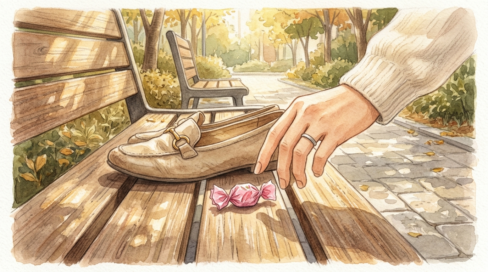

# 엄마 구두 속의 비밀

> 일상·드라마

## 1화

```text
[1화] 출근길 현관의 큰소리

오늘 아침도 현관에서 기어이 큰소리를 내고 말았다.

지각할까 봐 시계만 보며 발을 동동 구르는데, 다섯 살 아이가 자기 운동화는 안 신고 자꾸 현관에 놓인 내 출근용 구두를 붙잡고 꼼지락거렸다.

"엄마 지금 바쁜데 왜 자꾸 구두 가지고 장난쳐! 얼른 네 신발 신어!"

내 날 선 목소리에 아이는 어깨를 움츠리더니, 하고 싶던 말을 삼키듯 작은 입술만 삐죽였다.

구두를 급하게 구겨 신고 아이 손을 잡아끌어 어린이집에 들여보내는데, 돌아서는 내내 마음이 돌덩이를 삼킨 것처럼 무거웠다.
```

## 2화

```text
[2화] 구두 앞코의 이물감

어린이집 문을 나서서 지하철역으로 걸어가는데, 아까부터 구두 앞코에 무언가 자꾸 단단한 것이 배겼다.

급하게 나오느라 양말이 뭉쳤나 싶어 단지 안 벤치에 잠깐 서서 구두를 벗어 탈탈 털었다.

구두 안에서 툭 떨어진 건, 내 발열에 살짝 눌린 분홍색 딸기맛 마이쭈 하나였다.

어제 아이가 어린이집 생일파티에서 받아와서는, 아깝다며 먹지도 않고 내내 주머니에 넣고 만지작거리던 바로 그 사탕이었다.
```

## 3화

```text
[3화] 어젯밤의 한숨

벤치 위에 놓인 작은 사탕을 보자, 그제야 어젯밤 기억이 머리를 쳤다.

야근에 지쳐 퇴근한 뒤 소파에 널브러져 "아, 엄마 회사 일 진짜 힘들다…" 하고 무심코 중얼거렸을 때, 장난감을 내려놓고 가만히 내 얼굴을 들여다보던 아이의 까만 눈동자.

아침에 현관에서 내 구두를 붙잡고 꼼지락거리던 작은 손은 장난을 치던 게 아니었다.

엄마가 회사에 가져가도록 자기 보물 1호를 구두 깊숙이 숨겨주려던 참이었던 것이다.
```

## 4화

```text
[4화·완결] 나를 키우는 사랑

저녁에 하원한 아이를 품에 꼭 안고 사과하며 물었다.
"오늘 아침에 엄마 구두에 마이쭈 왜 넣어뒀어? 엄마가 모르고 화내서 미안해."

아이가 내 목을 꼬옥 끌어안으며 배시시 웃었다.
"엄마 회사 가서 힘들 때 몰래 꺼내 먹으라고! 구두 신으면 바로 찾을 줄 알았는데, 엄마가 그냥 신고 가버렸잖아."

나는 내 구두를 만지작거리던 작은 손을 '방해'라고 생각했고, 아이는 그 서툰 손으로 엄마의 고단한 하루를 응원하고 있었다.

내가 아이를 키우는 줄 알았는데, 사실은 아이의 엉뚱하고 거대한 사랑이 매일 나를 엄마로 키운다.

— 끝 —
```


