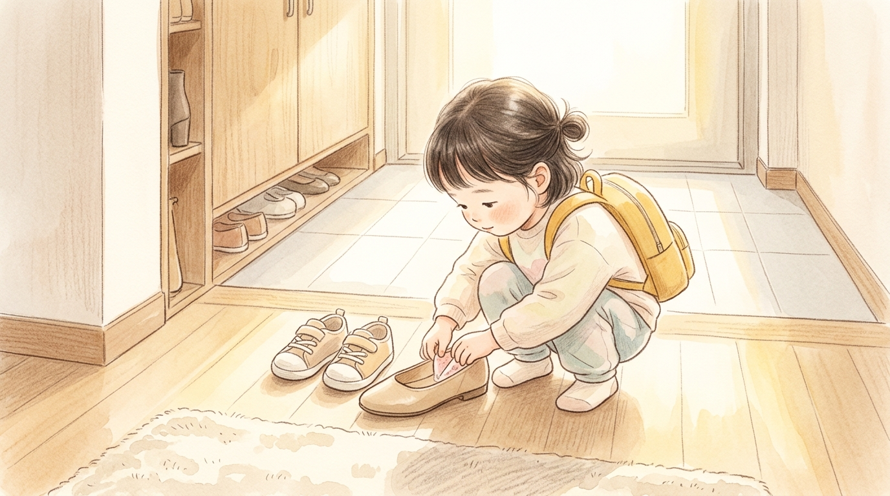
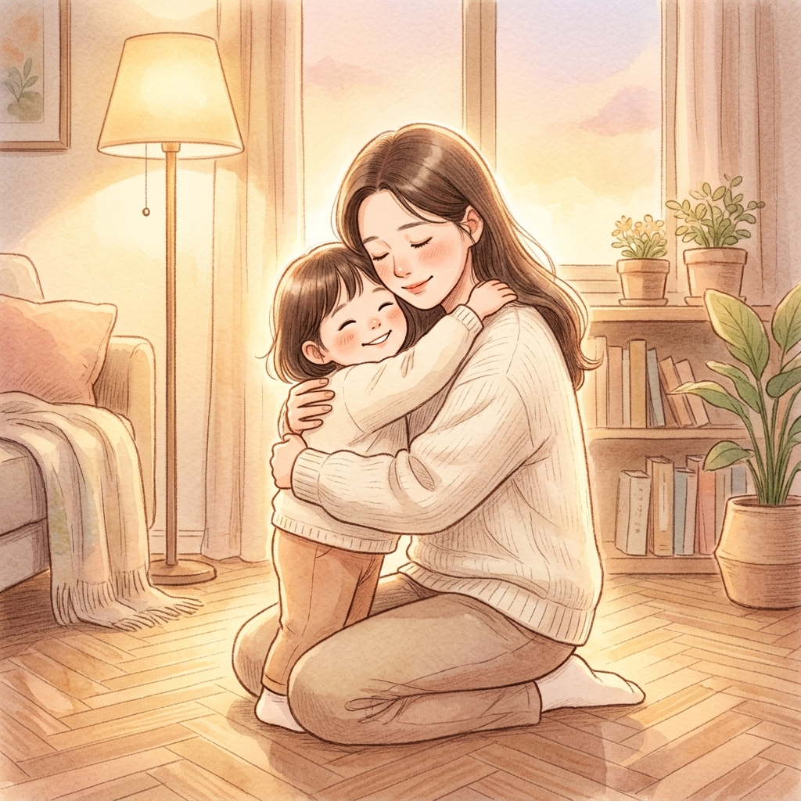

# 엄마 구두 속의 비밀 — Threads 연재본 (3화 완결)

> 장르: 일상·가족 휴먼 드라마 / 창작 단편 / 전 3화 완결
>
> **게시 방식:** 아래 각 `text` 블록의 본문만 복사하여 **1화당 1게시물**로 올리세요. 문장부호, 공백, 줄바꿈을 포함하여 각 화가 500자 이내입니다.

---

## 1화



```text
오늘 아침도 현관에서 기어이 큰소리를 내고 말았다.

출근 시간은 다가오는데, 다섯 살 아이가 자기 운동화는 안 신고 자꾸 현관에 놓인 내 구두를 붙잡고 꼼지락거렸다.

"엄마 지금 바쁜데 왜 자꾸 구두 가지고 장난쳐! 얼른 네 신발 신어!"

내 날 선 목소리에 아이는 어깨를 움츠리더니, 하고 싶던 말을 삼키듯 입술만 삐죽였다.

구두를 급하게 구겨 신고 아이 손을 잡아끌어 어린이집에 들여보내는데, 돌아서는 내내 마음이 돌덩이를 삼킨 것처럼 무거웠다.
```

## 2화


```text
어린이집 문을 나서는데 아까부터 구두 앞코에 무언가 자꾸 배겼다.
급하게 나오느라 양말이 뭉쳤나 싶어, 단지 벤치에 잠깐 서서 구두를 벗어 탈탈 털었다.

구두 안에서 툭 떨어진 건, 내 발열에 살짝 눌린 딸기맛 마이쭈 하나였다.
어제 어린이집 생일파티에서 받아와 아깝다며 먹지도 않고 주머니에 넣고 다니던 그 사탕이었다.

그제야 어젯밤 기억이 머리를 쳤다.
퇴근 후 소파에 널브러져 "아, 엄마 오늘 진짜 힘들다…" 하고 중얼거렸을 때, 가만히 내 얼굴을 들여다보던 아이의 눈동자가.
```

## 3화 (완결)



```text
저녁에 하원한 아이를 품에 꼭 안고 물었다.
"오늘 아침에 엄마 구두에 마이쭈 왜 넣어뒀어?"

아이가 내 목을 끌어안으며 배시시 웃었다.
"엄마 회사 가서 힘들 때 몰래 꺼내 먹으라고! 구두 신으면 바로 찾을 줄 알았는데, 엄마가 그냥 신고 가버렸잖아."

나는 내 구두를 만지작거리던 작은 손을 '방해'라고 생각했고, 아이는 그 서툰 손으로 엄마의 고단한 하루를 응원하고 있었다.

내가 아이를 키우는 줄 알았는데, 사실은 아이의 엉뚱하고 거대한 사랑이 매일 나를 엄마로 키운다.
```
